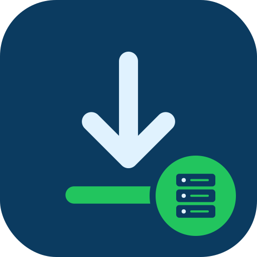

# Synology Download Assistant (Chrome extension)

  

A Chrome extension that sends downloads to the Download Station app on a
Synology NAS and manages them from the browser.

## What it does

- Adds downloads to Download Station from links and the context menu.
- Shows tasks and their statistics in a popup, and can pause, resume, delete or
  clear one task or all of them.
- Supports more than one DiskStation, with a default station.
- Comes in many languages through `_locales`.

## Contents

- `synologydownload`: the extension source (manifest version 1).
- `synologydownload.crx` and `synologydownload.zip`: packaged builds.
- `scripts/generate-en-locales.sh`: builds the English locale files.
- `website`: the PHP site for the extension.

## Tech

- JavaScript, HTML and CSS (Chrome extension)
- PHP and MySQL for the site

## Installing

Open `chrome://extensions`, turn on developer mode and load the
`synologydownload` folder as an unpacked extension. Chrome no longer accepts
manifest version 1, so it only loads in old versions.

## License

Licensed under the Apache License 2.0. See [LICENSE](LICENSE).
